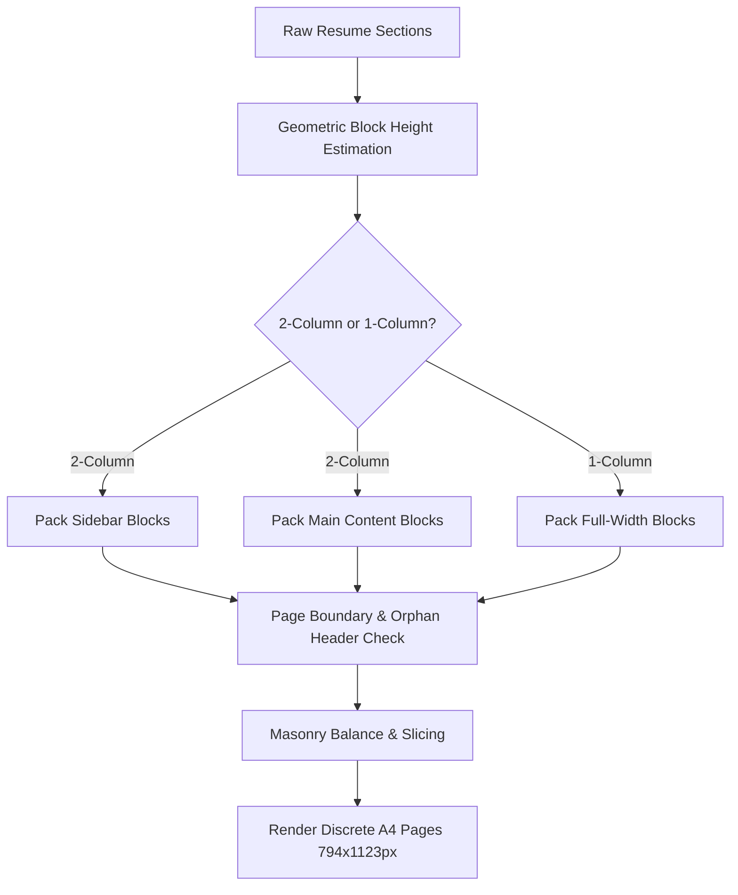

# CVSet — Next-Generation AI Resume Builder & ATS Job Tailor

[](https://react.dev/)
[](https://tailwindcss.com/)
[](https://vitejs.dev/)
[](https://vitest.dev/)
[](LICENSE)
[](#privacy--security)

**CVSet** is a powerful, privacy-first, client-side resume builder and AI-driven job tailoring platform. Designed for modern software engineers, leaders, and professionals, CVSet pairs algorithmic ATS optimization and target Job Description matching with a pixel-perfect, content-agnostic PDF layout and dynamic pagination engine.

Everything runs entirely in your browser — zero tracking, zero server uploads, and zero subscription paywalls.

---

## Table of Contents

- [Key Features](#key-features)
- [Templates Showcase](#templates-showcase)
- [Core Architecture](#core-architecture)
  - [1. Content-Agnostic Dynamic Pagination Engine](#1-content-agnostic-dynamic-pagination-engine)
  - [2. Client-Side PDF Ingestion & Parsing](#2-client-side-pdf-ingestion--parsing)
  - [3. AI Job Match & Tailoring Engine](#3-ai-job-match--tailoring-engine)
  - [4. Pixel-Perfect PDF Export](#4-pixel-perfect-pdf-export)
  - [5. Real-Time ATS Score Calculator](#5-real-time-ats-score-calculator)
- [Tech Stack](#tech-stack)
- [Project Structure](#project-structure)
- [Getting Started](#getting-started)
  - [Prerequisites](#prerequisites)
  - [Installation](#installation)
  - [Development Server](#development-server)
  - [Running Tests](#running-tests)
  - [Production Build](#production-build)
- [Testing & Quality Assurance](#testing--quality-assurance)
- [Privacy & Security](#privacy--security)
- [Contributing](#contributing)
- [License](#license)

---

## Key Features

- **Match Job AI Tailor**: Paste any job description to instantly analyze skill keyword overlap, title alignment, and missing competencies. One-click tailor synthesizes an ATS-optimized summary, re-orders skills, and injects industry keywords into bullet points.
- **Client-Side PDF Ingestion**: Directly upload your existing resume in PDF, JSON, TXT, or Markdown format. An integrated Mozilla `pdfjs-dist` parser reconstructs multi-column text, fixes letter-spacing, strips control characters, and auto-populates your profile.
- **Content-Agnostic Dynamic Pagination**: Mathematical bin-packing prevents awkward card splits, orphaned section headers, and empty trailing pages. Projects and employment records stay unified across discrete A4 pages (210mm × 297mm).
- **Executive & Developer Templates**: Includes Dublin, Stockholm, Sydney, Harvard, Berlin, and the flagship **Graphite** template featuring a warm-grey sidebar, charcoal header band, and independent 2-column masonry project distribution.
- **Dynamic Styling & Palette Controls**: 9 curated color themes (Royal Blue, Emerald, Deep Indigo, Violet, Crimson, Warm Amber, Teal Modern, Slate Charcoal, Midnight Black) and 4 professional font families (Inter, Outfit, Roboto, Merriweather).
- **Comprehensive ATS Scoring**: Evaluates contact completeness, action-oriented bullet phrasing, skill density, and educational background on an interactive 100-point scale with actionable suggestions.
- **Multiple Resumes Management**: Create, duplicate, tailor, and organize unlimited resumes persisted safely in local browser storage (`localStorage`).
- **High-Fidelity PDF Export**: Browser print stylesheets and high-resolution `html2canvas` + `jsPDF` multi-page slice rendering matching the live preview down to the exact pixel.

---

## Templates Showcase

| Template | Layout Style | Ideal For | Highlights |
| :--- | :--- | :--- | :--- |
| **Graphite** | 2-Column Sidebar + Masonry | Engineering Leaders, Tech Leads | Charcoal title band, warm-grey sidebar, full-width technology badge strip, zero vertical gap row stretching. |
| **Dublin** | 2-Column Modern | Full-Stack Developers, DevOps | Clean vertical split with distinct sidebar for skills, languages, and contact details. |
| **Stockholm** | 1-Column Minimalist | General Engineering, Data Science | High-density ATS-optimized single-column layout with high callback rates. |
| **Sydney** | Creative Header Banner | UI/UX Designers, Product Managers | Bold accent banner, rounded modern badges, and prominent header divider lines. |
| **Harvard** | Traditional Academic | Executives, Consultants, Academia | Classic serif typography (`Merriweather`), formal hairline dividers, balanced margins. |
| **Berlin** | Compact High-Density | Backend & Systems Engineers | Streamlined tech layout maximizing information density on 1–2 pages. |

---

## Core Architecture

### 1. Content-Agnostic Dynamic Pagination Engine

Traditional web-to-PDF generators suffer from clipped text, stranded single-line bullet points, and broken cards split across page boundaries. CVSet implements a dedicated pagination engine in [`src/utils/dynamicPaginator.js`](src/utils/dynamicPaginator.js) and [`src/utils/pagePaginator.js`](src/utils/pagePaginator.js):

- **Geometric Metric Estimation**: Dynamically calculates block heights based on character count per column width (36 chars/line for sidebar, 78 chars/line for main columns, 110 chars/line for full width).
- **Independent Column Flow**: Eliminates CSS Grid row-stretching gaps (e.g. where a 340px card paired with a 160px card previously created a 180px void). In the Graphite template, odd and even projects distribute independently into balanced masonry flex columns.
- **Orphan Header Prevention**: Section headings are bound to their first child block; if the child must move to the next page, the heading moves with it.
- **Page Overflow Safeguards**: A4 page height is strictly locked to 1,123px (at 96 DPI), maintaining uniform 45px padding and preventing subpixel rounding jitter from spilling over to blank trailing pages.



### 2. Client-Side PDF Ingestion & Parsing

CVSet extracts and parses resume content directly in the browser via [`src/utils/pdfExtractor.js`](src/utils/pdfExtractor.js):

- **Mozilla PDF.js Core**: Decompresses zlib/Flate-encoded binary streams client-side without sending files to external servers.
- **Layout & Column Separation**: Analyzes horizontal coordinates (`tx`) and vertical heights (`ty`) to separate left-hand sidebars from main content columns, preventing text interleaving.
- **Glyph & Letter-Spacing Restoration**: Normalizes artificial CSS letter spacing (e.g. `P R O F E S S I O N A L` &rarr; `PROFESSIONAL`) and strips private Unicode glyphs and null bytes (`\x00`).
- **Deep Semantic Extraction**: Extracts candidate name, job title, contact links (LinkedIn, GitHub, Portfolio), location, narrative summary, individual employment entries (title, employer, date range, location, bullets), projects (stacks, links, bullets), skills, education, and languages.

### 3. AI Job Match & Tailoring Engine

Implemented in [`src/utils/jobMatcher.js`](src/utils/jobMatcher.js), the algorithmic tailoring engine benchmarks a resume against any target Job Description:

- **Entity & Skill Extraction**: Analyzes JD text against a curated dictionary of 50+ technical and soft skill categories.
- **ATS Match Score**: Computes weighted scores across:
  - Technical Skill Overlap (60% weight)
  - Target Job Title Alignment (20% weight)
  - Executive Summary Keyword Density (20% weight)
- **Automated CV Tailoring**:
  1. Synchronizes candidate target role headline with the JD position.
  2. Crafts a tailored executive summary highlighting matching tenure and technical focus.
  3. Prioritizes matched skills to the top and seamlessly injects high-priority missing JD competencies.
  4. Augments recent employment bullet points with relevant action verbs and targeted technologies.

### 4. Pixel-Perfect PDF Export

PDF export ([`src/utils/pdfExport.js`](src/utils/pdfExport.js)) uses a dual-engine architecture:

1. **High-Resolution Canvas Slicing (`html2canvas` + `jsPDF`)**:
   - Clones DOM nodes at exact A4 dimensions (`794px × 1123px`, 96 DPI).
   - Unscales zoom transforms and zeros container scroll offsets to avoid cropped headers.
   - Slices discrete pages with subpixel boundary clamping to eliminate white line artifacts.
2. **Native Print Stylesheet**:
   - Complete `@media print` rules configured in [`src/index.css`](src/index.css) with `@page { size: A4 portrait; margin: 0; }`.
   - Strips non-printable UI buttons, navigation headers, and diagnostic panels automatically.

### 5. Real-Time ATS Score Calculator

[`src/utils/atsScore.js`](src/utils/atsScore.js) provides instant feedback across critical criteria:

- **Personal Information (20 pts)**: Name, target job title, verified contact information, and city/country location.
- **Professional Summary (20 pts)**: Presence of an elevator pitch with career trajectory and key metrics.
- **Work Experience (25 pts)**: Multiple employment records containing action-oriented bullet points (`•`).
- **Skills Coverage (15 pts)**: Minimum 6+ categorized technical and soft skills.
- **Education & Training (10 pts)**: Degree, university, and completion timeline.
- **Bonus Criteria (10 pts)**: LinkedIn, GitHub, portfolio links, language fluencies, and certifications.

---

## Tech Stack

| Technology | Purpose |
| :--- | :--- |
| **React 19** | Concurrent UI components, modern hooks, and state management |
| **Tailwind CSS v4** | Modern utility-first styling with `@tailwindcss/vite` |
| **Vite 6** | Ultra-fast HMR and optimized production bundling |
| **Vitest 3** | High-performance unit and integration test runner with JSDOM |
| **pdfjs-dist (v6)** | Mozilla's standard PDF client-side decompression and text extraction |
| **jsPDF & html2canvas** | High-fidelity canvas rasterization and multi-page A4 PDF generation |
| **Lucide React** | Clean, accessible iconography |
| **canvas-confetti** | Lightweight milestone celebration effects |

---

## Project Structure

```
cvset/
├── index.html                   # HTML entry point with web fonts
├── package.json                 # Project dependencies & scripts
├── vite.config.js               # Vite & Tailwind CSS plugins configuration
├── src/
│   ├── main.jsx                 # React root render
│   ├── App.jsx                  # Main routing, modal orchestration & views
│   ├── App.css                  # Core CSS animations
│   ├── index.css                # Tailwind CSS v4 & print @page rules
│   │
│   ├── assets/                  # Brand assets and SVG icons
│   │
│   ├── components/              # UI Components
│   │   ├── Navbar.jsx           # Top navigation bar
│   │   ├── LandingPage.jsx      # Marketing hero, feature cards, and CTA
│   │   ├── Dashboard.jsx        # Resume manager, quick actions, grid cards
│   │   ├── CreateResumeModal.jsx# Modal: Blank creation vs AI CV+JD tailor
│   │   ├── JobTailorModal.jsx   # Dedicated ATS match & diff inspection modal
│   │   ├── Footer.jsx           # Global footer
│   │   │
│   │   ├── ResumeEditor/        # Live Editor Components
│   │   │   ├── ResumeEditor.jsx           # Editor layout with split preview
│   │   │   ├── EditorToolbar.jsx          # Actions, palette, fonts, export
│   │   │   ├── PersonalDetailsForm.jsx    # Contact details & avatar
│   │   │   ├── SummaryForm.jsx            # Professional summary form
│   │   │   ├── ExperienceForm.jsx         # Work history with bullet editor
│   │   │   ├── EducationForm.jsx          # Academic history
│   │   │   ├── SkillsForm.jsx             # Skill pills & rating levels
│   │   │   ├── AdditionalSectionsForm.jsx # Projects, certifications, languages
│   │   │   ├── BulletTextarea.jsx         # Multi-line bullet point editor
│   │   │   ├── ScoreModal.jsx             # Interactive ATS score breakdown
│   │   │   └── SuggestionsModal.jsx       # 1-click pre-written AI suggestions
│   │   │
│   │   └── ResumePreview/       # Template Rendering & Preview
│   │       ├── ResumeRenderer.jsx         # Dynamic paginated template wrapper
│   │       ├── FormattedText.jsx          # Inline Markdown bold/italic parser
│   │       ├── SkillBar.jsx               # Visual skill rating bars
│   │       ├── LayoutDiagnosticsPanel.jsx # Height and page budget diagnostics
│   │       ├── GraphiteTemplate.jsx       # Graphite 2-column masonry layout
│   │       ├── DublinTemplate.jsx         # Dublin 2-column layout
│   │       ├── StockholmTemplate.jsx      # Stockholm minimalist layout
│   │       ├── SydneyTemplate.jsx         # Sydney creative banner layout
│   │       ├── HarvardTemplate.jsx        # Harvard classic serif layout
│   │       └── BerlinTemplate.jsx         # Berlin compact technical layout
│   │
│   ├── constants/               # Configs & sample data
│   │   ├── sampleData.js        # Comprehensive default resume dataset
│   │   └── templates.js         # Template metadata, colors, and typography
│   │
│   ├── utils/                   # Business Logic & Algorithms
│   │   ├── dynamicPaginator.js  # Content-agnostic height and page engine
│   │   ├── pagePaginator.js     # Discrete page slicing & column extraction
│   │   ├── pageBreaks.js        # Boundary detection and padding helpers
│   │   ├── pdfExtractor.js      # Client-side PDF.js decompression & parsing
│   │   ├── jobMatcher.js        # ATS scoring, JD analysis & CV tailoring
│   │   ├── pdfExport.js         # html2canvas + jsPDF multi-page export
│   │   ├── atsScore.js          # 100-point ATS evaluation algorithm
│   │   └── storage.js           # LocalStorage resume CRUD operations
│   │
│   └── tests/                   # Automated Vitest Test Suites
│       ├── atsScore.test.js
│       ├── bulletTextarea.test.jsx
│       ├── createResumeModal.test.jsx
│       ├── dynamicPaginator.test.js
│       ├── formattedText.test.jsx
│       ├── jobMatcher.test.js
│       ├── jobTailorModal.test.jsx
│       ├── pageBreaks.test.js
│       ├── pdfExport.test.js
│       ├── pdfExtractor.test.js
│       ├── pdfLayoutRegression.test.jsx
│       ├── resumeRenderer.test.jsx
│       ├── storage.test.js
│       └── templates.test.jsx
```

---

## Getting Started

### Prerequisites

- **Node.js**: `v18.0.0` or higher (Node 20+ recommended)
- **npm**: `v9.0.0` or higher

### Installation

Clone the repository and install dependencies:

```bash
git clone https://github.com/irshadmansuri046/cvset.git
cd cvset
npm install
```

### Development Server

Start the local Vite development server:

```bash
npm run dev
```

Open your browser at `http://localhost:5173/` to view the application with hot module replacement (HMR).

### Running Tests

Execute the Vitest automated test suite:

```bash
npm test
```

To run a specific test suite or pattern:

```bash
# Run PDF extractor and resume parser tests
npm test src/tests/pdfExtractor.test.js

# Run layout regression tests
npm test src/tests/pdfLayoutRegression.test.jsx
```

### Production Build

Compile and bundle the production-ready application:

```bash
npm run build
```

Preview the production build locally:

```bash
npm run preview
```

---

## Testing & Quality Assurance

CVSet is maintained with a comprehensive automated test suite consisting of **14 test suites and 155 unit & integration tests** covering:

- **PDF Ingestion & Glyph Extraction**: Verifies `pdfjs-dist` buffer parsing, uppercase unspacing, and structured section extraction.
- **ATS Match & Scoring Engine**: Validates skill dictionary lookup, keyword extraction, and score calculations.
- **Dynamic Pagination & Bin Packing**: Asserts that variable content distributions fit standard A4 heights without overflow or blank pages.
- **Component & Modal Workflows**: Tests modal transitions, template switching, and rich bullet point editing.
- **PDF Layout Regression Suite**: Verifies multi-page layout stability across Dublin, Stockholm, Sydney, Harvard, Berlin, and Graphite templates.

---

## Privacy & Security

- **100% Client-Side**: All document parsing, AI tailoring algorithms, and PDF rendering execute locally in the user's browser.
- **No Cloud Uploads**: Resumes, uploaded PDFs, job descriptions, and personal details are never transmitted over the network.
- **No Tracking or Cookies**: CVSet does not employ tracking cookies, third-party analytics, or data-collection telemetry.
- **Local Persistence**: Data is saved exclusively in your browser's private `localStorage`. You can export your data anytime as a clean JSON backup or wipe it completely by clearing browser storage.

---

## Contributing

Contributions, feature suggestions, and bug reports are welcome!

1. Fork the Project repository.
2. Create your Feature Branch (`git checkout -b feature/AmazingFeature`).
3. Commit your changes (`git commit -m 'feat: add AmazingFeature'`).
4. Ensure all tests pass (`npm test`).
5. Push to the Branch (`git push origin feature/AmazingFeature`).
6. Open a Pull Request.

---

## License

Distributed under the **MIT License**. See `LICENSE` for more information.

---

<p align="center">
  Crafted with precision for professionals who value privacy, speed, and design excellence.
</p>
